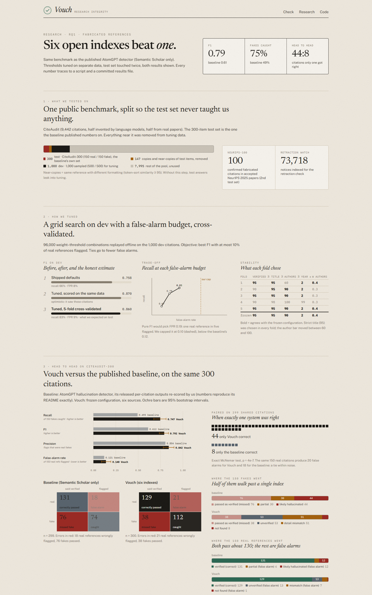
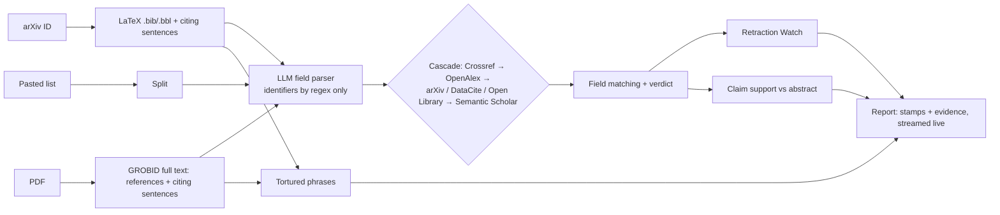

# Vouch — every citation, vouched for

**An open research-integrity screener.** Give it an arXiv ID, a PDF or a pasted reference list. For every reference
it checks whether the work **exists**, whether its **details are right**, whether it was **retracted**, whether it
**supports the sentence that cites it**, and it scans the paper for **paper-mill language**. Every verdict comes with
its evidence. Only open scholarly databases are used, so every result can be reproduced.

**Live demo:** https://vouch-theta-one.vercel.app · **Research results:** https://vouch-theta-one.vercel.app/research ·
**API:** https://139-84-216-217.sslip.io/api/health

Team Beyonders (Threws Odyssey 2026, DeepTech & Scientific Computing): Priyanshu Doshi, Viranshul, Kuldeep Goklani.

| A report: 6 confirmed NeurIPS 2025 fakes caught, 4 real references verified | Research page |
|---|---|
|  |  |

---

## The problem

- Papers citing references that do not exist went from **1 in 2,828** (2023) to **1 in 277** (early 2026) (GESIS, arXiv:2607.22693).
- **1 in 20** NeurIPS and USENIX Security papers carries two or more likely hallucinated references (arXiv:2607.00738). 100 confirmed fakes were found in *accepted* NeurIPS 2025 papers.
- The published open checker (AtomGPT detector, Semantic Scholar only) misses **half** of the fakes on its own benchmark, and existing tools each check one thing: existence, *or* retractions, *or* paper-mill phrases.

## What Vouch checks

| | Question | How |
|---|---|---|
| ① **Exists** | Is this a real work? | Cascade over six open indexes: Crossref → OpenAlex → arXiv / DataCite / Open Library (routed by reference type) → Semantic Scholar. Several candidates per source, stops at the first confident match |
| ② **Accurate** | Are title, authors, year, venue and DOI right? | Field-by-field matching tuned on held-out data. A real DOI attached to the wrong title (identifier hijacking) is caught first |
| ③ **Not retracted** | Was the cited work retracted or flagged? | 73,718 Retraction Watch notices (Crossref), by DOI, notice DOI, PubMed ID or exact title |
| ④ **Supports the claim** | Does the cited abstract support the citing sentence? | An open LLM compares the sentence with the abstract, must quote its evidence (quotes are checked against the abstract) and abstains when unsure |
| ⑤ **No paper-mill language** | Does the text contain tortured phrases? | 86 fingerprints such as "counterfeit consciousness" for "artificial intelligence" |

Verdict stamps: **Verified** · **Mismatch** (exists, details disagree) · **Not found** · **Unverified** (web pages, software, partial matches: sent to a human) · **Retracted**. Labels describe evidence, never people.

## Results

All numbers come from scripts in `eval/` and committed files in `eval/results/`; every run, including failures, is in [EXPERIMENTS.md](EXPERIMENTS.md).

**RQ1 — fabricated references (CiteAudit-300, the baseline's own benchmark; 150 real / 150 fake):**

| System | Precision | Recall | F1 [95% CI] | False-positive rate |
|---|---|---|---|---|
| AtomGPT detector (Semantic Scholar only; released outputs, re-scored exactly) | 0.804 | 0.493 | 0.612 [0.53, 0.68] | 0.121 |
| **Vouch** (frozen config, six sources) | **0.842** | **0.747** | **0.792** [0.74, 0.84] | 0.140 [0.09, 0.20] |

Paired on the same 299 citations: **44 cases only Vouch got right vs 8 only the baseline** (exact McNemar p = 4×10⁻⁷).
On 100 confirmed fakes from accepted NeurIPS 2025 papers: **99/100 flagged** (baseline 94/100).
The false-positive rate is *not* lower than the baseline's (20 vs 18 false alarms on the same citations; intervals overlap).

**RQ3 — what each part adds (dev set, 1,000 citations, offline replay):**
- Adding indexes in cascade order cuts real references wrongly flagged from **55% (Crossref only) → 12% → 7.8% → 6.2% (all six)**.
- With **title-only matching**, even six indexes reach F1 **0.607**, about the baseline; strict field matching gives **0.873**. Sources remove false alarms; field checks catch fakes.
- An **LLM judge for borderline matches made things worse** (it accepted 89 fakes for every 4 real references it rescued); cross-validation switched it off in 5 of 5 folds.

**RQ4 — claim support (SciFact dev, 340 expert-labelled claim–abstract pairs):** macro-F1 **0.843**, calibration error 0.038;
abstaining on the least-confident answers raises accuracy from 0.850 to **0.908 at 20% abstention**.

**RQ2 — who gets wrongly accused (225 real works sampled from OpenAlex, 5 types × 3 regions):** a single-index checker (baseline method re-created) flags **70% of real datasets** (68% as "likely hallucinated"), 36% of book chapters and 26% of reports, but only 5% of articles. Our hypothesis that Indian and Global South references are flagged more was **not** supported (India 22%, Global North 36%). Without OpenAlex, Vouch is no better than the baseline (30% vs 31%), so OpenAlex's coverage of non-article works is what matters; full Vouch's 5% is partly circular because the sample came from OpenAlex.

### Protocol
1. Reproduce the baseline from its released outputs (exact match to its README).
2. Split CiteAudit so no copy or near-copy (token-sort ≥ 95) of a test item is in the tuning data.
3. Tune weights and thresholds on dev only, 5-fold cross-validated, objective = best F1 with ≤ 10% of real references flagged; freeze.
4. Evaluate on the test sets. They were used **twice**, both runs reported: 5 sources (F1 0.781, FPR 0.187), then 6 sources (F1 0.792, FPR 0.140).

## How it works



- **Backend:** Python 3.12, FastAPI, httpx (async), Server-Sent Events, SQLite cache, GROBID 0.9.1. LLM: `deepseek-v4.1-flash` on Vultr Serverless Inference (OpenAI-compatible); about $0.0003 per reference.
- **Frontend:** Next.js 16, React 19, Tailwind 4. Charts are hand-written SVG.
- **Deploy:** Vultr VM (API + GROBID + Caddy HTTPS, Docker Compose) and Vercel. See [deploy/README.md](deploy/README.md).

## Try it

On the live site: the **NeurIPS 2025 fakes**, **Retracted papers** and **CiteAudit** example buttons (pre-run, instant), or the static **Demo mix**.
More inputs with expected results: [test-inputs/README.md](test-inputs/README.md).

Run locally:
```sh
docker run -d --name grobid -p 8070:8070 grobid/grobid:0.9.1-crf
cp .env.example .env            # add your keys (OpenAlex, Semantic Scholar, an OpenAI-compatible LLM)
cd backend && python -m venv .venv && .venv/Scripts/pip install -r requirements.lock
.venv/Scripts/python -m uvicorn app.main:app --port 8000
.venv/Scripts/python -m app.cli check --arxiv 2602.23452   # or --bib file.txt
cd ../frontend && npm install && npm run dev                # http://localhost:3000
```
Tests: `cd backend && .venv/Scripts/python -m pytest -m "not live"`.

## Repository

| Path | What |
|---|---|
| `backend/app/pipeline/` | resolvers (6 sources), `match.py` + `verdict.py` (field matching), `retraction.py`, `claims.py`, `tortured.py`, `run.py` (orchestrator), `tuned.json` (frozen config) |
| `backend/app/main.py` | HTTP API with live progress (SSE) and report cache |
| `eval/` | splits (indices + hashes only), collection, tuner, test evaluation, ablations, SciFact, CoverageSet; `results/` |
| `frontend/` | website: checker, live report, research page |
| `docs/` | [ideation](docs/IDEATION.md), [implementation plan](docs/IMPLEMENTATION_PLAN.md), [runbook](docs/STEPS.md), [hackathon brief](docs/HACKATHON.md) |

## Limitations

- The false-positive rate on CiteAudit-300 (0.140) is not below the baseline's (0.121). Most false alarms are very recent preprints and new book editions that no index holds yet.
- A record without an author list can verify a citation on title alone (the one NeurIPS miss). The fix is known but was not applied after the last test run.
- Claim support only reads abstracts; long citing sentences that cite several works mostly come back as "abstract can't tell".
- The tortured-phrase list is a curated subset and was not evaluated on a labelled corpus.
- CiteAudit counts any invented field as a fake, so a "mismatch" is a warning for a human, not an accusation.

## Data and credits

- **Semantic Scholar:** data from the Semantic Scholar Academic Graph API. Kinney et al., *The Semantic Scholar Open Data Platform*, arXiv:2301.10140 (2023).
- **OpenAlex:** Priem, Piwowar & Orr, arXiv:2205.01833 (2022) · **Crossref** metadata · **DataCite** · **Open Library** · **arXiv** API.
- **Retraction Watch** database, via Crossref.
- **CiteAudit** benchmark (arXiv:2602.23452; evaluation only, not redistributed) · **CiteAudit-300** and **NeurIPS-2025 hallucinated citations** and the baseline's released outputs from the AtomGPT hallucination detector (arXiv:2607.09774, Apache-2.0).
- **SciFact** (Wadden et al., EMNLP 2020, CC BY-NC 2.0).
- **Tortured phrases:** Cabanac, Labbé & Magazinov, arXiv:2107.06751 (2021); social-science fingerprints, Zenodo 14753785 (CC-BY-4.0).
- **GROBID** (Apache-2.0).

Dataset details: [eval/data/SOURCES.md](eval/data/SOURCES.md).

## License

Code: [MIT](LICENSE). Datasets keep their own licences (see above); CiteAudit is not redistributed.
