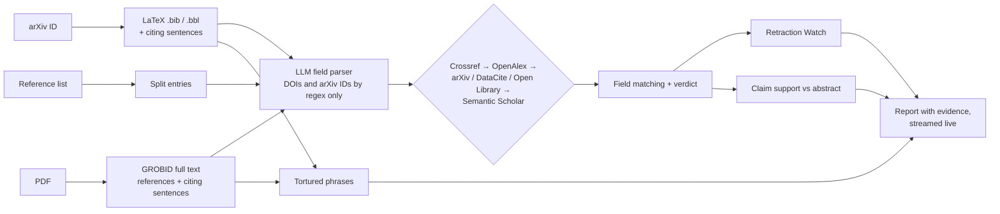

<p align="center">
  <picture>
    <source media="(prefers-color-scheme: dark)" srcset="docs/brand/vouch-logo-dark.png">
    
  </picture>
</p>

<p align="center">
  <b>The open research-integrity screener.</b><br/>
  Checks every reference in a paper: does it exist, are its details right, was it retracted, does it support the claim.<br/>
  Every verdict comes with its evidence.
</p>

<p align="center">
  <a href="https://vouch-theta-one.vercel.app"></a>
  <a href="https://youtu.be/OhIqgDQpIck"></a>
  <a href="https://vouch-theta-one.vercel.app/research"></a>
  <a href="LICENSE"></a>
  
  
</p>

<p align="center">
  <a href="https://vouch-theta-one.vercel.app"><b>Try it</b></a> ·
  <a href="https://youtu.be/OhIqgDQpIck"><b>Watch the demo</b></a> ·
  <a href="#quick-start"><b>Run it yourself</b></a> ·
  <a href="#results"><b>Results</b></a> ·
  <a href="#roadmap"><b>Roadmap</b></a> ·
  <a href="#contributing"><b>Contribute</b></a>
</p>

<br/>

<p align="center">
  
</p>

---

## Why Vouch

AI writing tools now produce references that look completely real but do not exist, and peer review is not catching them.

- Papers citing references that don't exist rose from **1 in 2,828 (2023) to 1 in 277 (early 2026)** (GESIS, arXiv:2607.22693).
- **100 fabricated citations** were confirmed inside papers *accepted* at NeurIPS 2025.
- Today's open checkers look in **one database**. The published AtomGPT detector (Semantic Scholar only) misses **about half of the fakes** on its own benchmark, and wrongly accuses real books, reports and datasets it cannot find.

Vouch is built for the people who have to trust a reference list: **authors** before they submit, **reviewers and conference chairs** screening submissions, and **journals and universities** that want an integrity check next to plagiarism detection.

## What it checks

| | Check | How |
|---|---|---|
| 🔎 | **Exists** | A cascade over six open scholarly indexes: Crossref → OpenAlex → arXiv / DataCite / Open Library (routed by reference type) → Semantic Scholar. Several candidates per source; stops at the first confident match. |
| 🧾 | **Accurate** | Title, authors, year, venue and DOI compared field by field. Handles initials, *et al.*, diacritics and name formats. A real DOI attached to the wrong title (identifier hijacking) is caught first. |
| ⛔ | **Not retracted** | 73,718 Retraction Watch notices, matched by DOI, notice DOI, PubMed ID or exact title. |
| 💬 | **Supports the claim** | An open LLM compares each citing sentence with the cited abstract, must **quote its evidence** (quotes are verified against the abstract) and **abstains** when unsure. |
| 🏭 | **No paper-mill language** | 86 tortured-phrase fingerprints in the full text, e.g. *"counterfeit consciousness"* for *"artificial intelligence"*. |

Every reference gets a stamp, never an accusation:

| Stamp | Meaning |
|---|---|
| ✅ **Verified** | A matching record exists and its details agree. |
| 🟧 **Mismatch** | The work exists, but authors, year, venue or DOI disagree with the record. |
| 🟥 **Not found** | No plausible record in any of the six indexes. |
| ⬜ **Unverified** | Web pages, software, reports or partial matches: sent to a human. |
| 🟪 **Retracted** | A retraction, concern or correction notice is on record. |

## Features

- **Three inputs:** an arXiv ID (reads the LaTeX source, including the sentences that cite each reference), a **PDF** (GROBID full-text model) or a **pasted reference list**.
- **Live report** streamed reference by reference, with an evidence card for each: the record found, field-by-field scores, the issue, the retraction notice or the quoted passage.
- **Export** as JSON or CSV.
- **Open data only:** every verdict can be reproduced from public sources.
- **Cheap:** about 0.03 cents of LLM cost per reference, and every lookup is cached.
- **Honest by design:** labels describe evidence, never people, and anything Vouch cannot verify goes to a human.

## Quick start

### Use it online
Open **https://vouch-theta-one.vercel.app**, paste an arXiv ID (e.g. `2602.23452`), upload a PDF or paste a reference list. The **NeurIPS 2025 fakes** and **Retracted papers** examples show every feature in a few seconds.

### Run it locally

You need Python 3.12, Node 22 and Docker (for GROBID, used only for PDFs).

```sh
git clone https://github.com/Priyanshu-byte-coder/vouch.git && cd vouch

# 1. PDF reader
docker run -d --name grobid -p 8070:8070 grobid/grobid:0.9.1-crf

# 2. Keys: OpenAlex and Semantic Scholar (free), any OpenAI-compatible LLM endpoint
cp .env.example .env    # then fill in the values

# 3. API
cd backend
python -m venv .venv && .venv/Scripts/pip install -r requirements.lock   # macOS/Linux: .venv/bin/pip
.venv/Scripts/python -m uvicorn app.main:app --port 8000

# 4. Website (new terminal)
cd frontend && npm install && npm run dev                                 # http://localhost:3000
```

### Command line

```sh
cd backend
.venv/Scripts/python -m app.cli check --arxiv 2602.23452
.venv/Scripts/python -m app.cli check --bib references.txt --out report.json
```

### HTTP API

```sh
curl -X POST https://139-84-216-217.sslip.io/api/check \
     -H "content-type: application/json" -d '{"arxiv_id": "2602.23452"}'
# -> {"job_id": "..."}; stream progress from /api/jobs/<id>/events (Server-Sent Events)
```

| Endpoint | Purpose |
|---|---|
| `POST /api/check` | `{"arxiv_id": "..."}` or `{"bibliography": "..."}` → job id |
| `POST /api/check/pdf` | multipart `file` (≤ 20 MB) → job id |
| `GET /api/jobs/{id}` | status, partial or final report |
| `GET /api/jobs/{id}/events` | live events: `parsed`, `ref_done`, `done`, `report` |
| `GET /api/health` | sources, GROBID and key status |

Self-hosting on a server (API + GROBID + automatic HTTPS with Docker Compose): see [deploy/README.md](deploy/README.md).

## How it works



Matching thresholds were tuned on held-out data with 5-fold cross-validation, under a cap of 10% of real references flagged, and then frozen (`backend/app/pipeline/tuned.json`).

## Results

Every number comes from a script in [`eval/`](eval) and a committed file in [`eval/results/`](eval/results). Every run, including failures and negative results, is logged in [EXPERIMENTS.md](EXPERIMENTS.md). Charts: **[research page](https://vouch-theta-one.vercel.app/research)**.

**Fabricated references.** On CiteAudit-300, the benchmark the published baseline reported on (150 real, 150 fake):

| System | Precision | Recall | F1 [95% CI] | False-positive rate |
|---|---|---|---|---|
| AtomGPT detector (Semantic Scholar only; released outputs, re-scored exactly) | 0.804 | 0.493 | 0.612 [0.53, 0.68] | 0.121 |
| **Vouch** (six indexes, frozen config) | **0.842** | **0.747** | **0.792** [0.74, 0.84] | 0.140 [0.09, 0.20] |

- Head to head on the same 299 citations, Vouch was right **44 times** where the baseline was wrong, versus **8** the other way (exact McNemar p = 4 × 10⁻⁷).
- **99 of 100** confirmed fabricated citations from accepted NeurIPS 2025 papers flagged (baseline 94).

**What each part adds** (1,000 held-out citations): adding indexes cuts real references wrongly flagged from **55% (Crossref only) to 6% (all six)**. Strict field matching gives F1 **0.87**, while title-only matching scores **0.61**, about the baseline. An **LLM judge for borderline matches made results worse**, so cross-validation switched it off.

**Claim support** (SciFact, 340 expert-labelled pairs): macro-F1 **0.84**; accuracy rises from 0.85 to **0.91** when the model may abstain on its least confident 20%.

**Who gets wrongly accused** (225 real works sampled by type and region): a single-database checker flags **70% of real datasets** and 36% of book chapters, but only 5% of articles. The regional bias we hypothesised was **not** found.

**Real papers** (30 recent arXiv papers, 1,910 references, every flag checked against outside evidence): **9 confirmed citation problems in 5 papers**, including real papers cited with four invented co-authors. Flag precision is **15%**, because real problems are rare (about 0.5% of references). A flag means "look here", never "fake".

<details>
<summary><b>Protocol and limitations</b></summary>

- The baseline was reproduced exactly from its released outputs.
- CiteAudit was split so that no copy or near-copy of a test item is in the tuning data.
- All tuning used separate data. The test sets were used twice and both runs are reported (5 sources: F1 0.781 / FPR 0.187; 6 sources: F1 0.792 / FPR 0.140).
- **Limitations:** our false-positive rate on CiteAudit-300 (0.140) is not below the baseline's (0.121); most false alarms come from venue abbreviations, works no index holds yet (very new preprints, theses, old papers) and name transliteration. Claim support reads abstracts only. The tortured-phrase list is a curated subset.
</details>

## Roadmap

Vouch is moving from hackathon prototype to product and research paper. Planned next:

- [ ] **Fewer false alarms:** full venue-abbreviation table (JHEP, JINST, PTEP…), transliteration-aware names, collaboration authors
- [ ] **More sources:** PubMed, DBLP, Unpaywall, INSPIRE-HEP, national and regional indexes
- [ ] **Claim support on full text**, not just abstracts
- [ ] **Integrations:** browser extension, Overleaf and Zotero plug-ins, a GitHub Action for LaTeX repositories
- [ ] **Batch screening** for conferences and journals, with a reviewer dashboard
- [ ] **A paper** on the evaluation: multi-index lookup, false accusations by reference type, and the real-paper audit

Ideas and requests are welcome in [Issues](https://github.com/Priyanshu-byte-coder/vouch/issues).

## Contributing

Contributions are welcome, especially new sources, venue abbreviations, matcher edge cases and labelled examples.

1. Fork the repository and create a branch.
2. Backend tests: `cd backend && .venv/Scripts/python -m pytest -m "not live"` (`-m live` hits the real APIs).
3. Frontend checks: `cd frontend && npx tsc --noEmit && npx eslint src`.
4. Any change that moves an evaluation number needs a new entry in [EXPERIMENTS.md](EXPERIMENTS.md). Never tune on the test sets.
5. Open a pull request describing what changed and why.

## Repository

| Path | What |
|---|---|
| [`backend/app/pipeline/`](backend/app/pipeline) | resolvers (6 sources), `match.py` + `verdict.py` (field matching), `retraction.py`, `claims.py`, `tortured.py`, `run.py` (orchestrator), `tuned.json` (frozen config) |
| [`backend/app/main.py`](backend/app/main.py) | HTTP API with live progress (SSE) and report cache |
| [`eval/`](eval) | splits (indices and hashes only), collection, tuner, test evaluation, ablations, SciFact, CoverageSet, audit; `results/` |
| [`frontend/`](frontend) | website: checker, live report, research page |
| [`deploy/`](deploy) | Docker Compose (API + GROBID + Caddy), VM script, runbook |
| [`video/`](video) | demo video source (animated slides + scripted live demo) |
| [`docs/`](docs) | [ideation](docs/IDEATION.md), [implementation plan](docs/IMPLEMENTATION_PLAN.md), [runbook](docs/STEPS.md), [hackathon brief](docs/HACKATHON.md), [submission](docs/SUBMISSION.md) |

## FAQ

**Does a red stamp mean the paper is fraudulent?**
No. A stamp describes the evidence Vouch found for one reference. Honest mistakes, new preprints and works outside the indexes all produce flags. Always look at the evidence card.

**Why not just ask an LLM whether a reference is real?**
We tried: an LLM judge accepted 89 fakes for every 4 real references it rescued, because it forgives one or two invented names in a long author list. Vouch uses LLMs only to parse references and compare claims, and keeps the existence check deterministic.

**Is my paper stored?**
Reports are kept in memory and in a lookup cache on the server for speed. Uploaded PDFs are not published anywhere.

## Built at Threws Odyssey 2026

Vouch was created by **Team Beyonders** for **[Threws Odyssey 2026](https://unstop.com/hackathons/threws-odyssey-2026-threws-the-research-world-1766434)** (Threws, The Research World), track **DeepTech & Scientific Computing**.

| | |
|---|---|
| **Team** | Priyanshu Doshi ([@Priyanshu-byte-coder](https://github.com/Priyanshu-byte-coder)) · Viranshul ([@Viranshul-P](https://github.com/Viranshul-P)) · Kuldeep Goklani ([@Kuldeeep18](https://github.com/Kuldeeep18)) |
| **Working demo** | https://vouch-theta-one.vercel.app |
| **Demo video** | https://youtu.be/OhIqgDQpIck |
| **Research results** | https://vouch-theta-one.vercel.app/research |
| **Tech stack** | Python 3.12, FastAPI, httpx (async), Server-Sent Events, SQLite cache, GROBID 0.9.1, rapidfuzz; deepseek-v4.1-flash on Vultr Serverless Inference; Next.js 16, React 19, Tailwind CSS 4; Docker Compose + Caddy on a Vultr VM; Vercel |
| **Submission text** | [docs/SUBMISSION.md](docs/SUBMISSION.md) |

## Data and credits

- **Semantic Scholar:** data from the Semantic Scholar Academic Graph API. Kinney et al., *The Semantic Scholar Open Data Platform*, arXiv:2301.10140 (2023).
- **OpenAlex:** Priem, Piwowar & Orr, arXiv:2205.01833 (2022) · **Crossref** metadata · **DataCite** · **Open Library** · **arXiv** API.
- **Retraction Watch** database, via Crossref.
- **CiteAudit** benchmark (arXiv:2602.23452; used for evaluation only, not redistributed) · **CiteAudit-300**, **NeurIPS-2025 hallucinated citations** and the baseline's released outputs from the AtomGPT hallucination detector (arXiv:2607.09774, Apache-2.0).
- **SciFact** (Wadden et al., EMNLP 2020, CC BY-NC 2.0).
- **Tortured phrases:** Cabanac, Labbé & Magazinov, arXiv:2107.06751 (2021); social-science fingerprints, Zenodo 14753785 (CC-BY-4.0).
- **GROBID** (Apache-2.0).

Dataset details: [eval/data/SOURCES.md](eval/data/SOURCES.md).

## Cite

If you use Vouch in your research, please cite it:

```bibtex
@software{vouch2026,
  title  = {Vouch: An Open Research-Integrity Screener for Fabricated, Inaccurate and Retracted Citations},
  author = {Doshi, Priyanshu and Viranshul and Goklani, Kuldeep},
  year   = {2026},
  url    = {https://github.com/Priyanshu-byte-coder/vouch},
  note   = {Team Beyonders, Threws Odyssey 2026}
}
```

## License

Code: [MIT](LICENSE). Datasets keep their own licences (see above); CiteAudit is not redistributed.

<p align="center"><sub>Evidence for human review, not an accusation.</sub></p>
