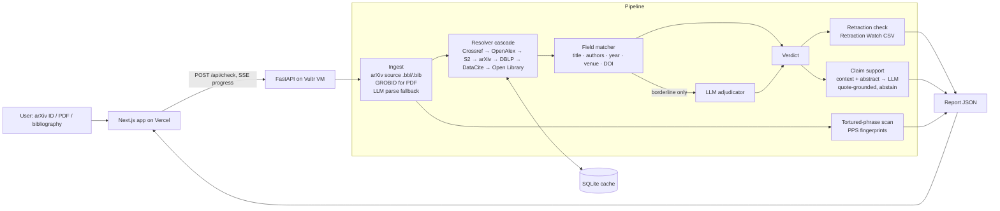

# CiteSentinel — Implementation Plan

> Written Tue 10 Nov 2026, 07:00 IST. **Submit by Thu 12 Nov, 23:00 IST** (portal closes 13 Nov 00:00). About 64 hours.
> Idea and research questions: [IDEATION.md](IDEATION.md). Running log: [../EXPERIMENTS.md](../EXPERIMENTS.md).

---

## 0. Scope: what "done" means

**MVP (must ship by Wed 11 Nov, 24:00)**
- [ ] Input: **arXiv ID** or **pasted bibliography**
- [ ] Checks ① Exists, ② Accurate, ③ Retracted, with evidence for each reference
- [ ] Web app: input page → live progress → report page (deployed, public URL)
- [ ] **RQ1** numbers vs. the published baseline on CiteAudit-300 + NeurIPS-100
- [ ] README with setup, results table and acknowledgements

**Then, in priority order (P1 → P4):**
1. **P1:** Check ④ claim support + **RQ4** on SciFact · **PDF upload** (GROBID)
2. **P2:** **RQ2** false-accusation study (CoverageSet) · **RQ3** ablations + cost/latency
3. **P3:** Check ⑤ tortured phrases · **RQ5** real-paper audit (hand-verified)
4. **P4:** Batch mode (many papers), downloadable report (JSON/CSV), research page with charts

Cut from the bottom if time runs out. Never cut RQ1 or the deployed demo.

---

## 1. Architecture



---

## 2. Tech stack

| Layer | Choice | Why |
|---|---|---|
| Backend | **Python 3.12, FastAPI, httpx (async), pydantic v2** | Fast to write, async fan-out to many APIs |
| Matching | **RapidFuzz**, `unidecode` (folds diacritics, e.g. Gražulis → Grazulis) | Same fuzzy matcher as the baseline, so the comparison is fair. Also fixes one of the baseline's documented limitations |
| PDF parsing | **GROBID** (Docker) → TEI XML; `pymupdf` for raw text | Standard tool for references and citation contexts |
| arXiv | arXiv API + e-print source (`.bbl`, `.bib`, `.tex`) | Most accurate reference and context extraction |
| LLM | **OpenAI-compatible client**. Default: **Vultr Serverless Inference** (we have credit); model is set by env var | Swappable. We log the exact model used in every result file |
| Cache | SQLite (`diskcache` or plain `sqlite3`) keyed by request | Rate limits + reproducible results |
| Frontend | **Next.js (App Router) + Tailwind + shadcn/ui**, on **Vercel** | Quick, polished UI |
| Charts | Recharts (web), matplotlib (paper figures) | — |
| Hosting | Vultr VM `vc2-2c-4gb` (Mumbai/Bangalore, ~$20/mo) running **docker compose**: `api` + `grobid` + `caddy` (automatic HTTPS via an `sslip.io` hostname) | GROBID needs about 4 GB RAM. Our team controls the deploy |
| Eval | Python scripts + Jupyter for figures; results committed as JSON | Reproducibility |

**External data and APIs (all free or open):**

| Source | Use | Access |
|---|---|---|
| Crossref REST | DOI lookup, bibliographic search | Free. Send `mailto` to use the polite pool |
| OpenAlex | Search + abstracts (`abstract_inverted_index`), country filters for RQ2 | **Free API key ($1/day budget, search ≈ $0.001)**. Get it on day 1 |
| Semantic Scholar | Title match, abstracts | Free API key (request on day 1; works without a key, but slower) |
| arXiv API + e-print | Metadata, LaTeX source | Free, max 1 request every 3 s |
| DBLP | CS venues | Free |
| DataCite | Datasets and software DOIs | Free |
| Open Library | Books (ISBN, title) | Free |
| Retraction Watch | Retractions, corrections, expressions of concern | [Crossref GitLab CSV](https://gitlab.com/crossref/retraction-watch-data), updated daily |
| PPS tortured-phrase fingerprints | Paper-mill language | [PPS fingerprints](https://www.irit.fr/~Guillaume.Cabanac/problematic-paper-screener/fingerprints/), [Zenodo 5031935](https://zenodo.org/record/5031935) |

**Benchmarks:**

| Dataset | Use | Source |
|---|---|---|
| **CiteAudit** (9,442 citations, full) | RQ1 dev split for tuning | [shiiiikw/CiteAudit](https://github.com/shiiiikw/CiteAudit) `benchmark.json` |
| **CiteAudit-300** (150 real / 150 fake) | RQ1 **test**, directly comparable to the published baseline | [atomgptlab/hallucination_detector](https://github.com/atomgptlab/hallucination_detector) `data/` (Apache-2.0) |
| **NeurIPS-2025-100** (confirmed fabrications) | RQ1 recall on real-world fakes | same repo |
| **SciFact** | RQ4 claim support | [allenai/scifact](https://github.com/allenai/scifact) |
| **CoverageSet** (we build it) | RQ2 false accusations by reference type and region | Real references from OpenAlex/Crossref reference lists + LLM-generated fakes |

> ⚠️ Exclude the 300 test citations from the dev split before tuning any threshold. We tune on dev and report on test, and say so in the README.

---

## 3. Repo layout

```
threws-odyssey-2026/
├── README.md                    # hackathon brief → becomes the project README before submission
├── EXPERIMENTS.md               # dated log of every run
├── docs/
│   ├── IDEATION.md
│   └── IMPLEMENTATION_PLAN.md
├── backend/
│   ├── app/
│   │   ├── main.py              # FastAPI app, routes, SSE
│   │   ├── models.py            # pydantic: ParsedRef, Candidate, RefResult, Report
│   │   ├── config.py            # env vars
│   │   ├── cache.py
│   │   ├── llm.py               # OpenAI-compatible client, JSON-mode helpers, token/cost logging
│   │   └── pipeline/
│   │       ├── ingest.py        # arXiv source / PDF→GROBID / plain text
│   │       ├── parse_refs.py    # .bbl/.bib parser, GROBID TEI parser, LLM fallback
│   │       ├── resolvers/       # crossref.py openalex.py s2.py arxiv.py dblp.py datacite.py openlibrary.py
│   │       ├── match.py         # field scoring
│   │       ├── verdict.py       # thresholds + LLM adjudicator
│   │       ├── retraction.py
│   │       ├── claims.py        # citation contexts + support check
│   │       ├── tortured.py
│   │       └── run.py           # orchestrates one paper → Report
│   ├── tests/
│   ├── requirements.txt
│   └── Dockerfile
├── frontend/                    # Next.js app
├── eval/
│   ├── data/                    # download scripts + small committed files (respect licences)
│   ├── baselines/atomgpt.py     # runs the published baseline with our LLM
│   ├── run_rq1_detection.py
│   ├── run_rq2_coverage.py
│   ├── run_rq3_ablation.py
│   ├── run_rq4_scifact.py
│   ├── run_rq5_audit.py
│   ├── results/                 # *.json outputs, committed
│   └── analysis.ipynb           # → figures/
├── docker-compose.yml           # api + grobid + caddy
└── .env.example
```

---

## 4. Pipeline details

### 4.1 Ingest and parse
| Input | Path |
|---|---|
| arXiv ID | Fetch metadata. Download the e-print. If there's a `.bbl`, parse `\bibitem` entries; if a `.bib`, parse with `bibtexparser`. Map `\cite{key}` in `.tex` to sentences for citation contexts |
| PDF | Run GROBID `processFulltextDocument`. References come from `<listBibl>`, contexts from `<ref type="bibr">` inside `<s>` |
| Pasted bibliography | Split entries (rules first, LLM if messy). Fields come from the LLM in JSON mode |

Fields for each reference: `raw, title, authors[], year, venue, doi, arxiv_id, isbn, url, type_guess (article|book|report|dataset|software|thesis|web|other)`.

### 4.2 Resolver cascade (check ①)
1. **DOI given:** Crossref `/works/{doi}` (DataCite if Crossref returns 404). If found but the title similarity is < 85, raise `IDENTIFIER_MISMATCH` and keep searching by title.
2. **arXiv ID given:** look up by ID on arXiv.
3. **Title search**, routed by `type_guess`:
   - Crossref `query.bibliographic` → OpenAlex `search` → S2 `paper/search/match` → DBLP (if CS) → DataCite (if dataset or software) → Open Library (if book or no venue)
   - **Stop early** once a candidate scores ≥ `T_accept`
4. Every API call is cached, rate-limited per source and logged with latency.

### 4.3 Field matching (check ②)
- `title`: RapidFuzz `token_set_ratio`, after normalising case, punctuation and LaTeX
- `authors`: surname + first initial, diacritics folded, `et al.` handled (score only the listed names), surname-first formats handled
- `year`: exact = 1, ±1 = 0.5 (preprint vs. published version)
- `venue`: fuzzy match + an abbreviation table for common venues (e.g. "Phys. Rev. Lett." ↔ "Physical Review Letters")
- Composite score = weighted sum. Starting weights: title 0.55 · authors 0.30 · venue 0.10 · year 0.05. **Tune the weights on the dev split only.**

### 4.4 Verdict
| Label | Rule (starting values, tuned on dev) |
|---|---|
| ✅ **Verified** | score ≥ 85 and author score ≥ 60 |
| 🟠 **Detail mismatch** | title ≥ 90 but authors, year, venue or DOI disagree. Report which fields |
| 🔴 **Not found** | no candidate ≥ 60 across all sources, and the type is indexable |
| ⚪ **Can't verify** | the type usually isn't indexed (web page, government report, software) or the score is 60–85 after AI review |

The **LLM adjudicator** runs only in the 60–85 band. It sees the raw reference plus the top 3 candidates and returns `{same_work: bool, confidence, reason}`.

### 4.5 Retraction (check ③)
- Load the RW CSV at startup into dicts keyed by normalised DOI and PMID.
- Flag `Retraction`, `Correction`, `Expression of concern` and `Reinstatement`, with the date and reasons.

### 4.6 Claim support (check ④)
1. Context = the citing sentence (± one sentence)
2. Evidence = abstract from OpenAlex, S2 or arXiv (full text if open access, P4)
3. The LLM returns `{label: SUPPORTS|CONTRADICTS|NOT_ENOUGH_INFO, confidence, evidence_quote}`
4. **Quote-grounding check:** `evidence_quote` must appear verbatim (fuzzy ≥ 95) in the evidence text. If not, the label becomes `NOT_ENOUGH_INFO`. This stops the checker itself from making things up
5. **Abstain** when confidence is below a threshold τ. τ is picked from the RQ4 accuracy-vs-coverage curve
6. **Cost control:** check at most N contexts per paper in the live demo (configurable). The full run happens in eval

### 4.7 Tortured phrases (check ⑤)
Compile the fingerprints into regexes (support `AND`/`NOT`) and scan the full text. Return the phrase, the expected wording and a snippet.

### 4.8 Report schema (API output)
```json
{
  "paper": {"title": "...", "source": "arxiv:2501.01234", "n_refs": 54},
  "summary": {"verified": 48, "detail_mismatch": 3, "not_found": 1, "cant_verify": 2,
              "retracted": 1, "claims_checked": 20, "claims_unsupported": 2, "tortured_hits": 0},
  "references": [{
    "idx": 12, "raw": "...", "parsed": {"title": "...", "authors": ["..."], "year": 2021},
    "status": "detail_mismatch", "confidence": 0.82,
    "match": {"source": "openalex", "id": "W123", "title": "...", "authors": ["..."], "year": 2020, "doi": "...", "url": "..."},
    "field_scores": {"title": 98, "authors": 50, "year": 0.5, "venue": 90},
    "issues": ["author list differs: cited 'Smith J', record 'Smyth J'", "year 2021 vs 2020"],
    "retraction": null,
    "claims": [{"context": "...", "label": "SUPPORTS", "confidence": 0.91, "evidence_quote": "..."}]
  }],
  "tortured": [{"phrase": "counterfeit consciousness", "expected": "artificial intelligence", "snippet": "..."}],
  "meta": {"models": {"parse": "...", "judge": "..."}, "seconds": 41.2, "llm_tokens": 18200, "cost_usd": 0.004}
}
```

### 4.9 API
| Method | Path | Body | Returns |
|---|---|---|---|
| POST | `/api/check` | `{"arxiv_id": "..."}` or `{"bibliography": "..."}` | `{"job_id"}` |
| POST | `/api/check/pdf` | multipart `file` | `{"job_id"}` |
| GET | `/api/jobs/{id}` | — | `Report` (partial while running) |
| GET | `/api/jobs/{id}/events` | — | SSE: `parsed`, `ref_done`, `claims_done`, `done` |
| GET | `/api/health` | — | status + source availability |

### 4.10 Frontend
- **`/`** — hero line + three input tabs (arXiv ID · Upload PDF · Paste bibliography) + "Try an example" buttons (pre-cached papers for a safe demo)
- **`/report/[id]`** — summary cards (counts by status) → filterable reference table → evidence drawer per reference (matched record, field scores, issues, retraction notice, claim checks with highlighted quote) → tortured-phrase panel → download JSON/CSV
- **`/research`** — our results: RQ1 table vs. baseline, RQ2 false-positive rate by type and region chart, RQ4 accuracy-vs-coverage curve, method summary, limitations
- Plain labels, no "fraud" wording. Footer: "Evidence for human review, not an accusation."

---

## 5. Evaluation plan

| Exp | What | Command (target) | Output |
|---|---|---|---|
| **E0** | Run the published baseline (AtomGPT detector) on CiteAudit-300 + NeurIPS-100 **with our LLM endpoint**. Also re-score their released outputs | `python eval/baselines/atomgpt.py` | `results/e0_baseline_*.json` |
| **E1 / RQ1** | Our cascade on the same sets (thresholds tuned on the CiteAudit dev split) | `python eval/run_rq1_detection.py --set citeaudit300` | P, R, F1, FPR, per error type |
| **E2 / RQ2** | Build CoverageSet: ~600 real references stratified by type (article/book/report/dataset/thesis) × region (IN + Global South vs. others), plus ~300 generated fakes in matching style. Run baseline vs. ours | `python eval/run_rq2_coverage.py` | FPR by stratum, recall |
| **E3 / RQ3** | Ablation: remove each source / remove the adjudicator / title-only matching | `python eval/run_rq3_ablation.py` | F1 and FPR deltas, seconds and $ per reference |
| **E4 / RQ4** | SciFact dev claims (labelled) vs. abstracts. Compare: (a) LLM direct, (b) + quote grounding, (c) + abstention | `python eval/run_rq4_scifact.py` | macro-F1, accuracy vs. coverage curve, ECE |
| **E5 / RQ5** | 200 recent arXiv papers (cs.CL / cs.LG / cs.AI, Nov 2026) + 50 Indian-affiliated papers. Every non-verified flag is hand-checked by 2 team members | `python eval/run_rq5_audit.py` | Prevalence, precision of flags (aggregate only) |

**Rules:**
- Fix random seeds and the model name.
- Commit every results JSON.
- Log every run in `EXPERIMENTS.md`: date, commit, config, numbers, notes.
- Report confidence intervals (bootstrap) for headline numbers.

---

## 6. Ownership

**Priyanshu owns everything** (pipeline, research, product, deployment), building with Claude Code. Viranshul and Kuldeep review and help with hand-checking where possible.

## 7. Timeline

The step-by-step order, owners and "done when" checks are in **[STEPS.md](STEPS.md)**. Checkpoints: Tue 23:00 (backend MVP) · Wed 24:00 (deployed MVP + P1) · Thu 14:00 code freeze · Thu 23:00 submit.

---

## 8. Unstop submission field mapping

| Field | Where it comes from |
|---|---|
| Project name | CiteSentinel |
| Problem statement | IDEATION §1 (short form) |
| Proposed solution | IDEATION §3 |
| Key features | The 5 checks + evidence drawer + 3 input modes + batch/API |
| Technology stack | §2 table |
| Source code | https://github.com/Priyanshu-byte-coder/citesentinel (public at submission time) |
| Working prototype | Vercel URL + example buttons + video |
| Implementation | §4 (condensed) + architecture diagram |
| Datasets and external resources | §2 data tables + model names + every AI tool used |
| Results / evaluation | RQ1–RQ5 tables from `eval/results`, with honest limitations |

---

## 9. Demo script (≤ 3 min)
1. **(0:00–0:25) Hook.** "1 in 277 papers now cites a reference that doesn't exist." Show a confirmed NeurIPS-2025 fake.
2. **(0:25–1:20) Live run.** Paste an arXiv ID and watch progress stream in. Open the report:
   - a ✅ book the baseline would have wrongly flagged
   - a 🟠 detail mismatch with a field-by-field diff
   - a 🔴 not-found reference
   - a retracted citation
3. **(1:20–1:50) Claim check.** Open a citation, see the highlighted evidence quote, and see an "unsure, needs review" case.
4. **(1:50–2:35) Research.** RQ1 table vs. baseline, RQ2 false-positive rate by type and region chart, RQ4 coverage curve. One sentence on the audit.
5. **(2:35–3:00) Impact.** Journals, conferences (ICSD), universities. Open sources, cents per paper. Limitations stated honestly.

---

## 10. Secrets and config (`.env`, never commit)
```
CROSSREF_MAILTO=
OPENALEX_API_KEY=
S2_API_KEY=
LLM_BASE_URL=https://api.vultrinference.com/v1
LLM_API_KEY=
LLM_MODEL_PARSE=
LLM_MODEL_JUDGE=
GROBID_URL=http://grobid:8070
CACHE_PATH=./cache.sqlite
```
The Vultr **account** API key was shared in chat. Rotate it after the hackathon, and never put it in the repo. The inference key is separate.

---

## 11. Budget (estimates, to be replaced with measured numbers)
| Item | Estimate |
|---|---|
| VM `vc2-2c-4gb` × ~6 days | ≈ $4 |
| LLM: parsing ~20K references + adjudicating ~3K + ~3K claim checks | ≈ $10–30 (Vultr inference: $0.55 / $2.75 per M input/output tokens) |
| OpenAlex | Free tier ($1/day). Watch the `/rate-limit` endpoint |
| **Total** | Well under the $200 credit |

---

## 12. Risks and fallbacks
| Risk | Fallback |
|---|---|
| S2 key doesn't arrive in time | Unauthenticated S2 + cache. The cascade leans on Crossref and OpenAlex |
| GROBID too heavy or unstable | arXiv-source path + LLM parsing of the PDF's text with `pymupdf` |
| An API is down during the live demo | Pre-cached example papers; recorded video as backup |
| LLM endpoint problems | Swap `LLM_BASE_URL` to any OpenAI-compatible provider (the code doesn't depend on one) |
| We can't beat the baseline | Report it honestly. Lead with RQ2 (false accusations) and the integrated report. Do error analysis on why |
| Running late | Cut in order P4 → P3 → P2. Never cut RQ1 or the deployed demo |
